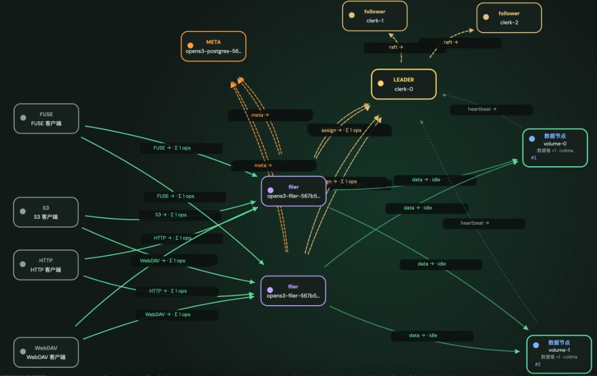

# OpenS3

> Language: [English](#opens3) · [中文](#opens3-zh)

Distributed object storage in Rust: Clerk (Raft) assigns volumes, Volume appends with sync replicas, unified Filer gateway (S3 + HTTP/WebDAV) with shared metadata.

**License:** [Apache License 2.0](LICENSE)

## Topology

Admin live topology (client → Filer → Meta / Volume, Clerk Raft on the top row):



After deploy, open `http://<filer>:8333/admin/ui` for the live view. See [Architecture](docs/en/architecture.md) and [Clients & gateways](docs/en/gateways.md).

## Documentation

| Language | Entry |
|----------|-------|
| **English (default)** | **[docs/en/](docs/en/README.md)** |
| 中文 | [docs/zh/](docs/zh/README.md) |

| Doc | English | 中文 |
|-----|---------|------|
| Quick start | [quickstart](docs/en/quickstart.md) | [中文](docs/zh/quickstart.md) |
| Install & build | [install](docs/en/install.md) | [中文](docs/zh/install.md) |
| Architecture | [architecture](docs/en/architecture.md) | [中文](docs/zh/architecture.md) |
| Clients & gateways | [gateways](docs/en/gateways.md) | [中文](docs/zh/gateways.md) |
| Modules | [modules](docs/en/modules/README.md) | [中文](docs/zh/modules/README.md) |
| Deployment | [deployment](docs/en/deployment.md) | [中文](docs/zh/deployment.md) |
| Kubernetes | [kubernetes](docs/en/kubernetes.md) | [中文](docs/zh/kubernetes.md) |
| Configuration | [configuration](docs/en/configuration.md) | [中文](docs/zh/configuration.md) |
| Using S3 | [s3](docs/en/s3.md) | [中文](docs/zh/s3.md) |
| Operations | [operations](docs/en/operations.md) | [中文](docs/zh/operations.md) |
| Monitoring | [monitoring](docs/en/monitoring.md) | [中文](docs/zh/monitoring.md) |
| Troubleshooting | [troubleshooting](docs/en/troubleshooting.md) | [中文](docs/zh/troubleshooting.md) |
| Development | [development](docs/en/development.md) | [中文](docs/zh/development.md) |
| Contributing | [contributing](docs/en/contributing.md) | [中文](docs/zh/contributing.md) |

## Quick start

From source:

```bash
cargo build --release
./target/release/opens3 server --dir ./data --max-volume-size-mb 64

# S3:    http://127.0.0.1:8333
# Admin: http://127.0.0.1:8333/admin/ui
# Clerk: http://127.0.0.1:9333
```

Docker Hub image (Clerk / Volume / Filer share one image):

```bash
docker pull jinopen/opens3:0.1.0
```

Helm defaults to `jinopen/opens3:0.1.0` — see [Kubernetes](docs/en/kubernetes.md).

```bash
curl -X PUT http://127.0.0.1:8333/demo
echo hello | curl -X PUT http://127.0.0.1:8333/demo/hello.txt --data-binary @-
curl http://127.0.0.1:8333/demo/hello.txt
```

For production, enable auth and run split processes — see [Deployment](docs/en/deployment.md) and [S3 auth](docs/en/s3.md).

## Features

- Hot path **volume-level replicas** (strong writes), cold volumes **async EC**
- Clerk **persistent Raft** (RequestVote / AppendEntries)
- Under-replica **heal**, capacity **balance**, Prometheus **metrics**
- S3: SigV4, Multipart, Versioning, Lifecycle, Bucket Policy
- Apache-2.0

## Tests

```bash
cargo test --workspace
bash tests/e2e_fault.sh
bash tests/e2e_kill_replica.sh
bash tests/e2e_clerk_failover.sh
bash tests/e2e_seal_ec.sh
bash tests/e2e_multi_s3.sh
bash tests/s3_compat/run.sh
```

---

<a id="opens3-zh"></a>

# OpenS3（中文）

用 Rust 实现的分布式对象存储：Clerk（Raft）分配卷、Volume 追加存储与同步副本、统一 Filer 网关（S3 + HTTP/WebDAV）与共享元数据。

**文档：** [English](docs/en/README.md) · [中文](docs/zh/README.md)

```bash
cargo build --release
./target/release/opens3 server --dir ./data --max-volume-size-mb 64
# S3 http://127.0.0.1:8333 · Admin /admin/ui · Clerk :9333

docker pull jinopen/opens3:0.1.0
```

完整中文文档见 [docs/zh/](docs/zh/README.md)；镜像与 Helm 见 [安装](docs/zh/install.md) / [Kubernetes](docs/zh/kubernetes.md)。
