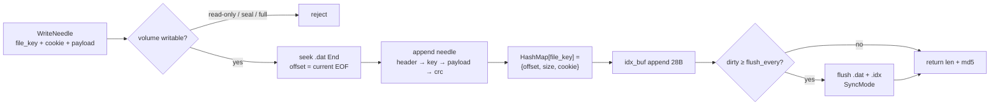
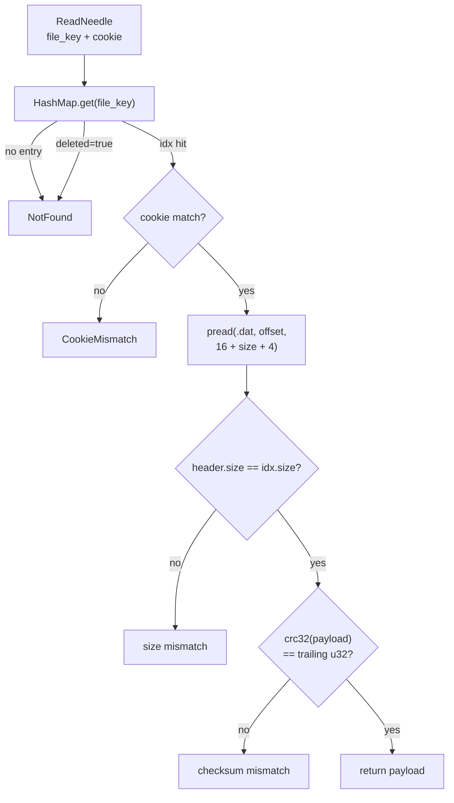
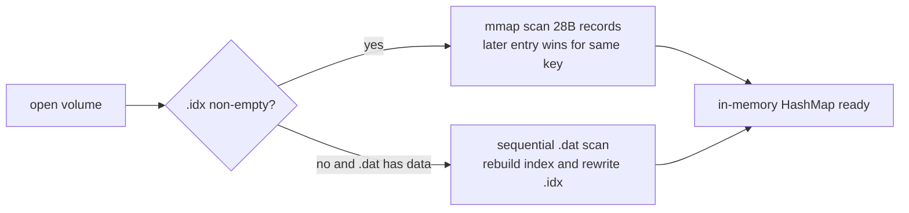

> Language: [English](./needle.md) · [中文](../../zh/modules/needle.md)

# Needle data structures

Volume appends object bytes on disk in **Needle** units. Implementation: `crates/opens3-volume/src/needle.rs`; constants `NEEDLE_HEADER_SIZE` / `NEEDLE_CHECKSUM_SIZE` live in `opens3-common`.

## File roles

```text
<data-dir>/
  {volumeId}.dat   # append needle records (sequential write)
  {volumeId}.idx   # append index log (fixed 28 B/entry; later entry wins for same file_key)
```


| File   | Role                                                                      |
| ------ | ------------------------------------------------------------------------- |
| `.dat` | Object body; append-only; soft delete does not reclaim holes              |
| `.idx` | `file_key → (offset, size, cookie, deleted)`; startup mmap scan into in-memory `HashMap` |


Runtime read path: **idx locate →** `pread` ****`.dat` **→ verify cookie / CRC**; does not move the write cursor.

## `.dat` Needle layout

All fields are **little-endian**.

```text
┌──────────────── header 16 B ────────────────┬──────── body = size ────────┬─ 4 B ─┐
│ cookie │ size │ flags │ pad │ ttl │          │ file_key │ payload…        │ crc32 │
│  u32   │ u32  │  u8   │ 3B  │ u32 │          │   u64    │   N bytes       │  u32  │
└─────────────────────────────────────────────┴─────────────────────────────┴───────┘
  0        4      8       9     12              16         24                 16+size
```


### Field table


| Field      | Offset      | Len | Type  | Notes                                                              |
| ---------- | ----------- | --- | ----- | ------------------------------------------------------------------ |
| `cookie`   | 0           | 4   | `u32` | Matches cookie in FileId; prevents ID guessing                     |
| `size`     | 4           | 4   | `u32` | **body length only** = `8 + payload.len()` (excludes header / CRC) |
| `flags`    | 8           | 1   | `u8`  | Reserved; currently written as `0`                                 |
| `pad`      | 9           | 3   | —     | Pad to 16 B header                                                 |
| `ttl`      | 12          | 4   | `u32` | Expiry seconds (set at write; may be cleared to 0 on compact rewrite) |
| `file_key` | 16          | 8   | `u64` | Part of body; counted in `size`                                    |
| `payload`  | 24          | N   | bytes | Object content                                                     |
| `crc32`    | `16 + size` | 4   | `u32` | `crc32(payload)`, excludes `file_key`                              |


### Length relations

```text
NEEDLE_HEADER_SIZE   = 16
NEEDLE_CHECKSUM_SIZE = 4
on_disk_total        = 16 + size + 4
                     = 16 + (8 + N) + 4
                     = 28 + N
```

Where `N = payload.len()`.

### Example

When `payload` is 24 bytes:


| Segment    | Bytes  |
| ---------- | ------ |
| header     | 16     |
| `file_key` | 8      |
| payload    | 24     |
| crc32      | 4      |
| **Total**  | **52** |


The `size` field value is `32` (`8 + 24`).

## `.idx` record layout

Fixed `IDX_ENTRY_SIZE = 28`, append-written; when multiple entries share a `file_key`, the **last one wins**.

```text
┌─ file_key ─┬─ offset ─┬─ size ─┬─ cookie ─┬ del ┬ pad ┐
│    u64     │   u64    │  u32   │   u32    │ u8  │ 3B  │
│     8      │    8     │   4    │    4     │  1  │  3  │
└────────────┴──────────┴────────┴──────────┴─────┴─────┘
  0            8          16       20         24    25
```


| Field      | Len | Notes                                              |
| ---------- | --- | -------------------------------------------------- |
| `file_key` | 8   | Lookup key                                         |
| `offset`   | 8   | Start offset of this needle in `.dat`              |
| `size`     | 4   | Same as needle header `size` (body length)         |
| `cookie`   | 4   | Must match on read                                 |
| `deleted`  | 1   | `≠0` means soft-deleted (tombstone)                |
| pad        | 3   | Alignment                                          |


In-memory structure: `NeedleIndex { offset, size, cookie, deleted }`.

## Write flow (diagram)

Writes are **sequential appends**: a new needle is always appended to the end of `.dat`; the index updates memory first, then async-batches to `.idx`.




### How the disk grows on write

```text
before write .dat                      after write .dat
┌──────────────┐                       ┌──────────────┬──────────────────────────┐
│ existing     │                       │ existing     │ new needle @ offset=EOF  │
│ needles      │                       │ needles      │                          │
└──────────────┘                       └──────────────┴──────────────────────────┘
               ▲ EOF                                  ▲
               │                                      │ write start = old EOF
               │                                      │ new EOF = offset + 16+size+4

in-memory HashMap                      .idx (after batched flush)
┌─────────────────────┐                ┌────────────────────────────────┐
│ key → {offset,…}    │  ──stage→      │ …old records… │ new 28B (tail) │
└─────────────────────┘                └────────────────────────────────┘
```

Writing the same `file_key` again: **do not mutate the old needle**; append a new needle + new idx; HashMap points at the latest offset (old data becomes garbage until compact).

### Write path steps (mapped to code)

1. Check volume is not read-only / not sealed, and `size + need ≤ max_size`
2. `seek` to end of `.dat`, record `offset`; write header → `file_key` → payload → `crc32(payload)`
3. `HashMap.insert(file_key, NeedleIndex{offset,size,cookie})`; prior live record for same key counts toward deleted stats
4. Append 28B to `idx_buf`; default flush every **64** ops (`OPENS3_VOLUME_IDX_FLUSH_EVERY`)
5. `SyncMode`: `none` / `data` (default) / `all` (`OPENS3_VOLUME_SYNC`)

### Crash recovery on open (truncate torn tail)

When opening a volume, scan `.dat` sequentially: verify length and **CRC** per record; stop at the **first incomplete or CRC-failed** record.

```text
.dat (after power loss)
┌──────── complete ────────┬─ torn EOF ─┐
│ needle… │ needle… │ …   │ partial junk│
└──────────────────────────┴────────────┘
                           ▲
                     good_end = end of last CRC-ok needle
                     set_len(good_end)  — truncate tail only; do not wipe the whole file
```

Also truncate `.idx` to a multiple of 28B and drop entries pointing past `good_end`. Complete needles are **all retained**.

---

## Read addressing (diagram)

The read path does **not** scan `.dat`: look up `offset` in the in-memory index by `file_key`, then `pread` the full needle.



Filer `BlobClient::read_blob`: after `lookup` gets all locations, try them in order (gRPC, then HTTP on failure). CRC/connection failures switch replicas; success returns; only after all fail is an error reported.


### Addressing sketch (how offset maps to bytes)

```text
FileId / request
  volume_id ──► open {id}.dat / in-memory index
  file_key  ──► HashMap lookup
  cookie    ──► compare with idx.cookie

HashMap[file_key]
        │
        │  { offset: 4096, size: 32, cookie: 0xA1B2, deleted: false }
        ▼
.dat byte axis
0          4096                    4096+16+32+4
│── … ──│◄────── pread window ──────►│── … ──│
           │ header(16) │ key(8)+payload │ crc(4) │
           └────────────┴────────────────┴───────┘
                              │
                              ▼ after checks, return payload only
```

Reads do **not** move the `.dat` write cursor (`pread` / `read_exact_at`), so they can run concurrently with appends (volume-level `RwLock`: multi-reader, single-writer).

### Where the index comes from on startup




---


## Delete and Compact (sketch)


### Delete `delete_needle`

Does not modify `.dat`; only appends an idx entry with `deleted=true`. Space is reclaimed by compact.

```text
.dat:  [needle A][needle B][needle C]     ← bytes untouched
.idx:  … → (B, deleted=1)                 ← append another tombstone
HashMap[B].deleted = true                 ← reads immediately NotFound
```


### Vacuum / Compact

Four phases (temps `.cpd`/`.cpx`, commit marker `.cpc`):

1. **check** — `garbage_ratio = deleted / (live + deleted)`
2. **compact** — copy live needles to `.cpd` + compact `.cpx` (writes blocked)
3. **commit** — write `.cpc`, then rename over `.dat`/`.idx` and reload
4. **cleanup** — remove leftover temps

One-shot `compact()` = compact → commit → cleanup. Clerk leader can auto-schedule by threshold.

```text
old .dat:  [A][B✗][C][B' live]   →  new .dat: [A][C][B']
old .idx:  many log entries / holes →  new .idx: three compact records
```

## Relation to FileId

Client / Filer FileIds typically contain **volume_id + file_key + cookie**. On the Volume side:

- use `file_key` to find idx  
- use `cookie` against forged / guessed IDs  
- payload is the object content; CRC covers payload only


## Design notes

- **Append write, sequential I/O**: friendly to small-object throughput.  
- **idx separated from dat**: hot index updates need not rewrite historical needles.  
- **Soft delete + compact**: fast delete path; space reclaimed asynchronously.  
- **CRC excludes key**: key is already checked via idx / header path; CRC focuses on content integrity.


## Related docs

- [Volume module](volume.md) — replication, EC, ops APIs, heartbeat  
- [Architecture overview](../architecture.md) — end-to-end read/write paths
