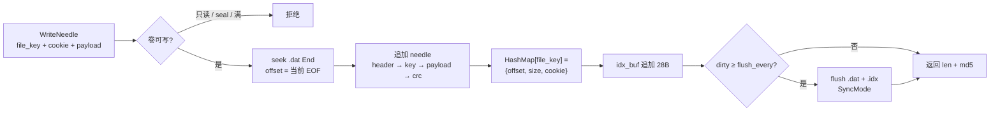
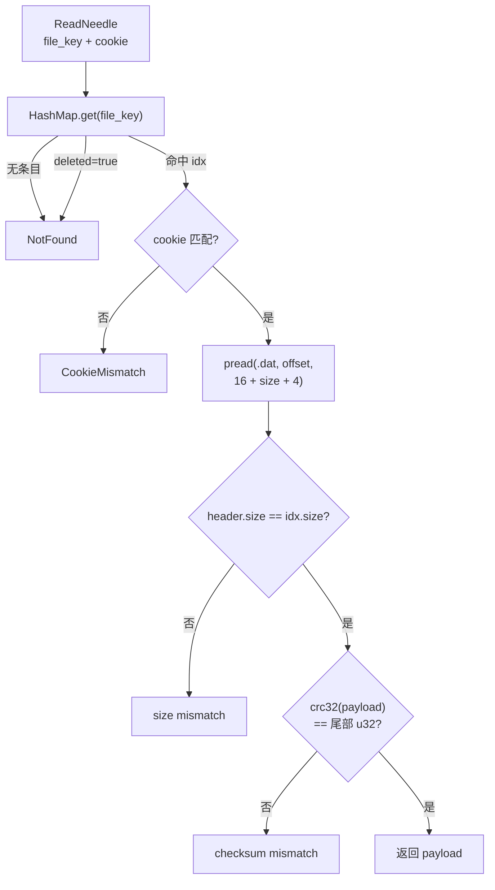
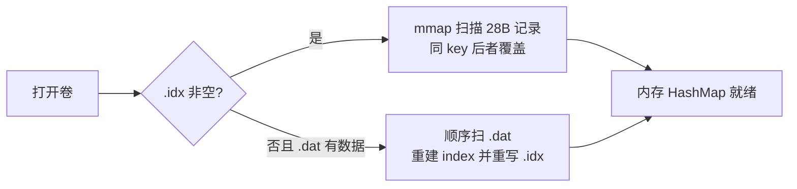

> 语言: [English](../../en/modules/needle.md) · [中文](./needle.md)

# Needle 数据结构

Volume 在磁盘上以 **Needle** 为单位追加存储对象字节。实现见 `crates/opens3-volume/src/needle.rs`；常量 `NEEDLE_HEADER_SIZE` / `NEEDLE_CHECKSUM_SIZE` 在 `opens3-common`。

## 文件角色

```text
<data-dir>/
  {volumeId}.dat   # 追加 needle 记录（顺序写）
  {volumeId}.idx   # 追加索引日志（定长 28 B/条，同 file_key 后者覆盖）
```


| 文件     | 作用                                                                   |
| ------ | -------------------------------------------------------------------- |
| `.dat` | 对象正文；只追加，软删不回收空洞                                                     |
| `.idx` | `file_key → (offset, size, cookie, deleted)`；启动时 mmap 扫入内存 `HashMap` |


运行时读路径：**idx 定位 →** `pread` ****`.dat` **→ 校验 cookie / CRC**，不移动写游标。

## `.dat` Needle 布局

全部字段 **little-endian**。

```text
┌──────────────── header 16 B ────────────────┬──────── body = size ────────┬─ 4 B ─┐
│ cookie │ size │ flags │ pad │ ttl │          │ file_key │ payload…        │ crc32 │
│  u32   │ u32  │  u8   │ 3B  │ u32 │          │   u64    │   N bytes       │  u32  │
└─────────────────────────────────────────────┴─────────────────────────────┴───────┘
  0        4      8       9     12              16         24                 16+size
```


### 字段表


| 字段         | 偏移          | 长度  | 类型    | 说明                                                   |
| ---------- | ----------- | --- | ----- | ---------------------------------------------------- |
| `cookie`   | 0           | 4   | `u32` | 与 FileId 中 cookie 一致；防猜测 ID                          |
| `size`     | 4           | 4   | `u32` | **仅 body 长度** = `8 + payload.len()`（不含 header / CRC） |
| `flags`    | 8           | 1   | `u8`  | 预留；当前写入为 `0`                                         |
| `pad`      | 9           | 3   | —     | 对齐到 16 B header                                      |
| `ttl`      | 12          | 4   | `u32` | 过期秒数（写入时带入；compact 重写时可能置 0）                         |
| `file_key` | 16          | 8   | `u64` | 属 body；计入 `size`                                     |
| `payload`  | 24          | N   | bytes | 对象内容                                                 |
| `crc32`    | `16 + size` | 4   | `u32` | `crc32(payload)`，不含 `file_key`                       |


### 长度关系

```text
NEEDLE_HEADER_SIZE   = 16
NEEDLE_CHECKSUM_SIZE = 4
on_disk_total        = 16 + size + 4
                     = 16 + (8 + N) + 4
                     = 28 + N
```

其中 `N = payload.len()`。

### 示例

`payload` 为 24 字节时：


| 段          | 字节     |
| ---------- | ------ |
| header     | 16     |
| `file_key` | 8      |
| payload    | 24     |
| crc32      | 4      |
| **合计**     | **52** |


`size` 字段值为 `32`（`8 + 24`）。

## `.idx` 记录布局

定长 `IDX_ENTRY_SIZE = 28`，追加写；同 `file_key` 多条时 **最后一条生效**。

```text
┌─ file_key ─┬─ offset ─┬─ size ─┬─ cookie ─┬ del ┬ pad ┐
│    u64     │   u64    │  u32   │   u32    │ u8  │ 3B  │
│     8      │    8     │   4    │    4     │  1  │  3  │
└────────────┴──────────┴────────┴──────────┴─────┴─────┘
  0            8          16       20         24    25
```


| 字段         | 长度  | 说明                                  |
| ---------- | --- | ----------------------------------- |
| `file_key` | 8   | 查找键                                 |
| `offset`   | 8   | 该 needle 在 `.dat` 中的起始偏移            |
| `size`     | 4   | 与 needle header 中 `size` 一致（body 长） |
| `cookie`   | 4   | 读时必须匹配                              |
| `deleted`  | 1   | `≠0` 表示软删（tombstone）                |
| pad        | 3   | 对齐                                  |


内存结构对应 `NeedleIndex { offset, size, cookie, deleted }`。

## 写入流程（图形）

写入是 **顺序追加**：新 needle 永远接到 `.dat` 末尾；索引先更新内存，再异步批量落到 `.idx`。




### 写入时磁盘如何长出来

```text
写前 .dat                          写后 .dat
┌──────────────┐                   ┌──────────────┬──────────────────────────┐
│ 已有 needles │                   │ 已有 needles │ 新 needle @ offset=EOF   │
└──────────────┘                   └──────────────┴──────────────────────────┘
               ▲ EOF                              ▲
               │                                  │ write 起点 = 旧 EOF
               │                                  │ 新 EOF = offset + 16+size+4

内存 HashMap                       .idx（批量 flush 后）
┌─────────────────────┐            ┌────────────────────────────────┐
│ key → {offset,…}    │  ──stage→  │ …旧记录… │ 新 28B 记录（末尾） │
└─────────────────────┘            └────────────────────────────────┘
```

同 `file_key` 再写一次：**不改旧 needle**，再追加一条新 needle + 新 idx；HashMap 指向最新 offset（旧数据成垃圾，等 compact）。

### 写路径步骤（对照代码）

1. 检查卷未只读 / 未 seal，且 `size + need ≤ max_size`
2. `seek` 到 `.dat` 末尾，记下 `offset`；写 header → `file_key` → payload → `crc32(payload)`
3. `HashMap.insert(file_key, NeedleIndex{offset,size,cookie})`；同 key 旧活记录计入 deleted 统计
4. `idx_buf` 追加 28B；默认每 **64** 次 `flush`（`OPENS3_VOLUME_IDX_FLUSH_EVERY`）
5. `SyncMode`：`none` / `data`（默认）/ `all`（`OPENS3_VOLUME_SYNC`）

### 启动崩溃恢复（截断残尾）

打开卷时顺序扫描 `.dat`：逐条校验长度与 **CRC**，在**第一条不完整或 CRC 失败**处停下。

```text
.dat（掉电后）
┌──────── complete ────────┬─ torn EOF ─┐
│ needle… │ needle… │ …   │ 半截垃圾   │
└──────────────────────────┴────────────┘
                           ▲
                     good_end = 最后一条 CRC 通过处
                     set_len(good_end)  — 只砍尾巴，不整文件清空
```

同时把 `.idx` 裁成 28B 整数倍，并丢掉指向 `good_end` 之后的条目。完整 needle **全部保留**。

---

## 读取寻址（图形）

读路径 **不扫** `.dat`：用 `file_key` 在内存索引里拿到 `offset`，再 `pread` 定点读整条 needle。



Filer `BlobClient::read_blob`：`lookup` 得到全部 location 后依次尝试（gRPC，失败再 HTTP）。CRC/连接失败会换副本，成功则返回；全部失败才报错。


### 寻址示意（offset 如何落到字节）

```text
FileId / 请求
  volume_id ──► 打开 {id}.dat / 内存 index
  file_key  ──► HashMap 查找
  cookie    ──► 与 idx.cookie 比对

HashMap[file_key]
        │
        │  { offset: 4096, size: 32, cookie: 0xA1B2, deleted: false }
        ▼
.dat 字节轴
0          4096                    4096+16+32+4
│── … ──│◄────── pread 窗口 ──────►│── … ──│
           │ header(16) │ key(8)+payload │ crc(4) │
           └────────────┴────────────────┴───────┘
                              │
                              ▼ 校验通过后只返回 payload
```

读 **不移动** `.dat` 写游标（`pread` / `read_exact_at`），可与追加写并发（卷级 `RwLock`：多读一写）。

### 启动时索引从哪来




---


## 删除与 Compact（简图）


### 删 `delete_needle`

不改 `.dat`，只追加一条 `deleted=true` 的 idx；空间靠 compact 回收。

```text
.dat:  [needle A][needle B][needle C]     ← 字节不动
.idx:  … → (B, deleted=1)                 ← 再追加一条 tombstone
HashMap[B].deleted = true                 ← 读立即 NotFound
```


### Compact

```text
旧 .dat:  [A][B✗][C][B'活]     →  新 .dat: [A][C][B']
旧 .idx:  多条日志 / 空洞       →  新 .idx: 三条紧凑记录
```

遍历存活 needle → 重写干净 `.dat` → 截断重写紧凑 `.idx`。

## 与 FileId 的关系

客户端 / Filer 持有的 FileId 通常含 **volume_id + file_key + cookie**。Volume 侧：

- 用 `file_key` 找 idx  
- 用 `cookie` 防伪造 / 防猜 ID  
- payload 才是对象内容；CRC 只管 payload


## 设计要点

- **追加写、顺序 I/O**：小对象吞吐友好。  
- **idx 与 dat 分离**：热更新索引不必改写历史 needle。  
- **软删 + compact**：删路径快，空间异步回收。  
- **CRC 不含 key**：key 已在 idx / header 链路校验；CRC 专注内容完整性。


## 相关文档

- [Volume 模块](volume.md) — 复制、EC、运维 API、心跳  
- [架构总览](../architecture.md) — 端到端读写路径

